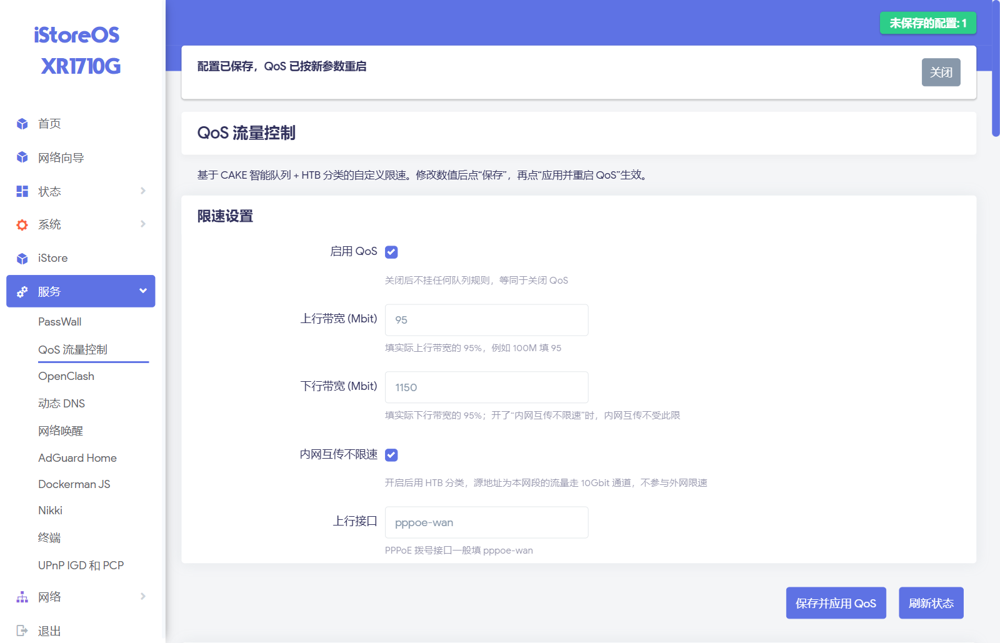

# luci-app-qoscustom

[](LICENSE)

在 **没有 `ifb` 内核模块** 的 OpenWrt / iStoreOS 上也能用的 QoS（流量整形）LuCI 应用。

基于内核自带的 **CAKE** + **HTB**，带 Web 管理界面：能看实时统计、能改带宽、内网互传不限速。

> **English TL;DR** — A LuCI app that provides CAKE-based QoS on OpenWrt builds where the
> `ifb` kernel module is unavailable (so stock SQM can't be installed). Download traffic is
> shaped on the LAN bridge egress instead of via IFB, with a u32 filter that exempts LAN-to-LAN
> traffic so your internal 2.5G/10G transfers stay unthrottled.



---

## 它解决什么问题

标准做法是装 OpenWrt 官方的 **SQM**（`sqm-scripts` + `luci-app-sqm`），但它有一个硬依赖：

```
sqm-scripts → kmod-ifb → 需要内核编译 ifb 模块
```

很多路由器固件（例如 Airoha/MTK 平台的 iStoreOS 社区版）**内核里没有 `ifb`**，于是：

```
$ apk add sqm-scripts
ERROR: unable to select packages:
  kmod-ifb (no such package): required by: sqm-scripts
```

**下行整形就彻底没方案了。**

本项目的做法：

| 方向 | 常规 SQM 做法 | 本项目做法 |
|---|---|---|
| 上行 | CAKE on `pppoe-wan` | 相同 ✅ |
| 下行 | IFB 虚拟网卡接流量 | **在 `br-lan` 出口限速 + HTB 分类** |

> 下行流量最终都要从 `br-lan` 出去到客户端，所以在出口限速效果等价；
> 再用 `u32` 过滤器把**源地址属于内网**的流量分流到一条 10 Gbit 的“不限速通道”，
> 这样 NAS ↔ 电脑的内网互传不会被打到宽带带宽。

```
       ┌──────────── br-lan (root htb) ────────────┐
       │  class 1:10  rate 10Gbit   ← 内网互传(e 豁免) │
       │  class 1:20  rate 1150Mbit ← 外网下载        │
       │      └─ qdisc cake 20:                      │
       └────────────────────────────────────────────┘
```

**注意：限速算法本身不是本项目的**——CAKE 和 HTB 都是 Linux 内核自带（`sch_cake.ko` / `sch_htb.ko`）。
本项目只提供了**编排脚本 + UCI 配置 + LuCI 页面**（约 60 行 shell + 120 行 JS）。
唯一的“原创设计”就是上面那个 **HTB 分类替代 IFB** 的思路。

---

## 环境要求

| 依赖 | 说明 | 检查命令 |
|---|---|---|
| OpenWrt / iStoreOS（LuCI 21.02+） | 需要 JS 版 LuCI | `cat /etc/openwrt_release` |
| 内核有 `sch_cake.ko` / `sch_htb.ko` | 绝大多数现代内核都自带 | `ls /lib/modules/$(uname -r)/ \| grep sch_cake` |
| **`tc` 命令** | 有些精简固件没打包它（见下方“没有 tc 怎么办”） | `tc -V` |

### 没有 `tc` 怎么办

如果 `which tc` 为空、且 `apk search iproute2-tc` / `opkg list | grep tc` 都找不到，
可以从 **Alpine Linux 同架构包**里取一个（musl + aarch64 与 OpenWrt 兼容）：

```sh
# 在 PC 上（以 aarch64 为例）
curl -LO https://dl-cdn.alpinelinux.org/alpine/v3.20/main/aarch64/iproute2-tc-6.9.0-r0.apk
tar -xzf iproute2-tc-6.9.0-r0.apk sbin/tc usr/lib/tc
scp -O sbin/tc root@192.168.1.1:/usr/bin/tc
scp -O usr/lib/tc/* root@192.168.1.1:/usr/lib/tc/
ssh root@192.168.1.1 'chmod +x /usr/bin/tc && tc -V'
```

依赖库（`libmnl` / `libelf` / `libbpf`）OpenWrt 一般都有；`ldd /usr/bin/tc` 可以确认。

---

## 安装

预编译产物在 [Releases](https://github.com/o2606063-cyber/luci-app-qoscustom/releases) 页面：

| 资产 | 适用 | 说明 |
|---|---|---|
| `luci-app-qoscustom_1.0.0-1_all.ipk` | **opkg** 系统（OpenWrt ≤ 23.x） | 架构无关（`all`），任何平台都能装 |
| `luci-app-qoscustom-1.0.0-all.tar.gz` | **任意系统**（含 apk） | 便携包，解压后跑 `install.sh` |

### 方式一：opkg 系统直接装包

```sh
wget -O /tmp/qos.ipk https://github.com/o2606063-cyber/luci-app-qoscustom/releases/download/v1.0.0/luci-app-qoscustom_1.0.0-1_all.ipk
opkg install /tmp/qos.ipk
```

### 方式二：apk 系统 / 任意系统（便携包，推荐）

> ⚠️ **本项目暂不提供预编译 `.apk` 包。**
> apk v2 格式的包必须由 OpenWrt SDK 里的 `abuild` 生成（含签名段与 datahash 结构），
> 手工拼装的包会被 `apk` 拒绝（`v2 package format error` / `unexpected end of file`）。
> 在 apk 系统上请用下面的便携包，效果与装包完全相同。

```sh
wget -O /tmp/qos.tar.gz https://github.com/o2606063-cyber/luci-app-qoscustom/releases/download/v1.0.0/luci-app-qoscustom-1.0.0-all.tar.gz
cd /tmp && tar xzf qos.tar.gz && cd luci-app-qoscustom-1.0.0
sh install.sh
```

脚本会做四件事：复制文件 → 关流量卸载 → 重启 `rpcd`/`uhttpd` 并清 LuCI 缓存 → 启动 QoS 服务。

### 方式三：从源码一键安装

```sh
git clone https://github.com/o2606063-cyber/luci-app-qoscustom.git
cd luci-app-qoscustom
sh install.sh
```

### 方式四：作为 OpenWrt 软件包编译（含 `.apk`）

把本目录放进你的 feed（例如 `package/luci-app-qoscustom`），然后用官方 SDK 编译：

```sh
# 产出 .ipk（OpenWrt ≤23.x）
make package/luci-app-qoscustom/compile V=s

# 产出 .apk（OpenWrt 24.10+ / iStoreOS 2.x，使用 apk-tools 3）
make package/luci-app-qoscustom/compile V=s
```

SDK 会自动生成符合 apk 规范的包（含 `datahash` 与签名段），这是获得 `.apk` 的唯一可靠方式。

### 方式五：手动复制

```sh
# 1. 复制文件
cp -r root/* /
cp -r htdocs/* /www/          # overview.js → /www/luci-static/resources/view/qoscustom/
chmod +x /etc/init.d/qos-custom

# 2. 清缓存 + 重启
rm -rf /tmp/luci-indexcache* /tmp/luci-modulecache
/etc/init.d/rpcd restart && /etc/init.d/uhttpd restart

# 3. 启用服务
/etc/init.d/qos-custom enable
/etc/init.d/qos-custom start
```

安装后从 **LuCI → 服务 → QoS 流量控制** 进入。

---

## 配置项

配置文件：`/etc/config/qoscustom`

| 选项 | 默认 | 说明 |
|---|---|---|
| `enabled` | `1` | 是否启用 |
| `uplink_mbit` | `95` | 上行带宽（Mbit），建议填真实带宽的 **95%** |
| `downlink_mbit` | `1150` | 下行带宽（Mbit），同上 |
| `lan_bypass` | `1` | 内网互传豁免（关掉后内网流量也会被限速） |
| `interface` | `pppoe-wan` | 上行接口（PPPoE 拨号口） |
| `lan_iface` | `br-lan` | 下行接口（LAN 网桥） |

带宽为什么要设 95%：整形器必须比真实线路**略小**才能把队列建在自己的缓冲区里。
设成 100% 会让包堆积在 ISP 的设备上，bufferbloat（延迟暴涨）依旧存在。

命令行改也行：

```sh
uci set qoscustom.settings.uplink_mbit='95'
uci commit qoscustom
/etc/init.d/qos-custom restart
```

---

## ⚠️ 重要：必须关闭流量卸载

QoS 靠 `tc` 队列调度，而 **flow offloading 会让数据包绕过协议栈**，直接跳过队列：

```sh
uci set firewall.@defaults[0].flow_offloading='0'
uci set firewall.@defaults[0].flow_offloading_hw='0'
uci commit firewall
/etc/init.d/firewall reload
```

`install.sh` 会自动帮你处理这一步。

**代价**：关闭硬件卸载后转发全部走 CPU，极高带宽（>2.5 Gbps）时可能成为瓶颈。
如果发现极限速度明显下降，可以在「保速度」和「保 QoS」之间二选一。

---

## 验证

```sh
# 上行规则
tc qdisc show dev pppoe-wan
#   qdisc cake ... bandwidth 95Mbit besteffort dual-srchost nat ...

# 下行规则
tc class show dev br-lan
#   class htb 1:10 ... rate 10Gbit     ← 内网豁免通道
#   class htb 1:20 ... rate 1150Mbit   ← 外网整形通道

# 实时统计（看哪类流量多）
tc -s class show dev br-lan
```

LuCI 页面底部也会实时显示这些输出。

---

## 常见问题

### 服务“启动成功”但规则没生效

新版 `/etc/rc.common` 统一用 **procd** 调度，只认 `start_service()` / `stop_service()`。
如果你的项目是从老教程抄的 `start()`，它会**返回 0、没有报错、也没有日志**，但一行都不执行。

诊断：

```sh
sh -x /etc/rc.common /etc/init.d/qos-custom start | tail -40
```

本项目已使用 `start_service()`。

### 改完带宽不生效

`uci commit` 之后必须 `restart` 服务；LuCI 上点「保存并应用 QoS」会自动完成这两步。

### 内网传输变慢了

检查 `lan_bypass` 是否为 `1`，以及 `tc -s class show dev br-lan` 里 `1:10` 的包数是否在涨。
另外确认 `LAN_CIDR` 与你的实际网段一致（默认 `192.168.50.0/24`，改脚本顶部即可）。

---

## 目录结构

```
.
├── htdocs/luci-static/resources/view/qoscustom/overview.js   # LuCI 页面
├── root/etc/config/qoscustom                                 # 默认配置
├── root/etc/init.d/qos-custom                                # 服务（读 UCI 挂 tc 规则）
├── root/usr/share/luci/menu.d/luci-app-qoscustom.json        # 菜单
├── root/usr/share/rpcd/acl.d/luci-app-qoscustom.json         # 权限
├── install.sh                                                # 一键安装
├── uninstall.sh                                              # 卸载
└── Makefile                                                  # OpenWrt 软件包
```

## 致谢

- [CAKE](https://www.bufferbloat.net/projects/codel/wiki/Cake/) — 内核自带的智能队列
- [OpenWrt SQM](https://github.com/openwrt/packages/tree/master/net/sqm-scripts) — 本项目思路的来源与对照

## License

[MIT](LICENSE)
